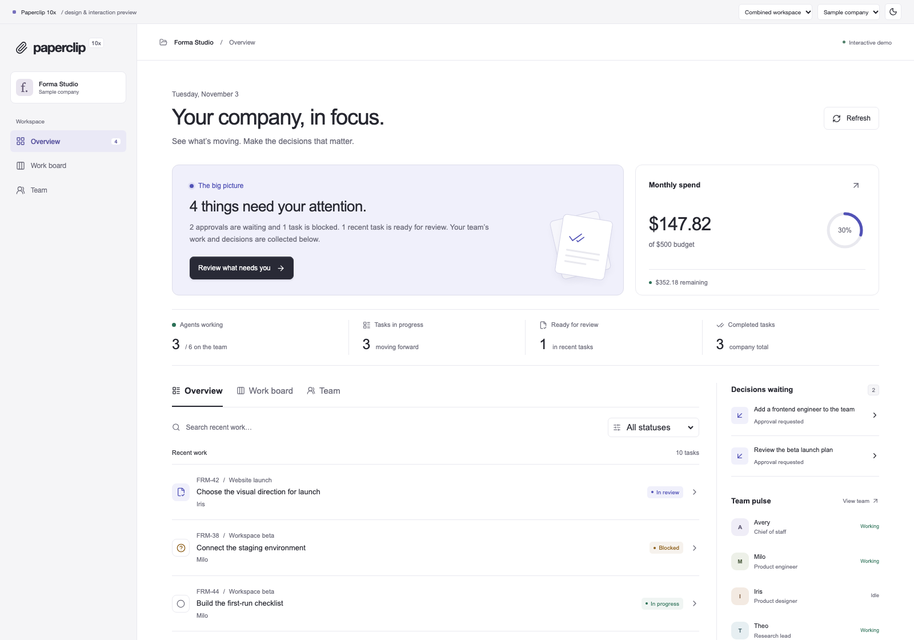

<p align="center"><strong>Paperclip / 10x</strong></p>
<h1 align="center">A calmer workspace for running an AI team.</h1>
<p align="center">An operator-focused UI contribution to <a href="https://github.com/paperclipai/paperclip">Paperclip</a>, directed by Megan (@megandmartin).</p>
<p align="center"><a href="#try-the-workspace">Try the workspace</a> · <a href="doc/CONTRIBUTIONS.md">What this fork adds</a> · <a href="doc/UPSTREAM-REVIEW.md">Upstream review</a> · <a href="doc/VERIFICATION.md">Verification</a> · <a href="LICENSE">MIT license</a></p>

[](https://github.com/megandmartin/paperclip-10x/actions/workflows/operator-workspace.yml)



Paperclip already provides the machinery for coordinating agents: companies, tasks, approvals, budgets and execution. This fork explores a more composed way to see that work and choose the next action.

**The contribution is a working UI, a company-scoped data adapter and a documented design rationale.** The screenshot and standalone demo use clearly labelled sample data. See the [mobile](doc/assets/operator-workspace-mobile.png), [dark](doc/assets/operator-workspace-dark.png), [work board](doc/assets/operator-reimaginer.png) and [decision desk](doc/assets/operator-converter.png) views.

## What’s added

- **A practical board fix.** Keep long task boards scrollable with sticky stage headers and keyboard access. The patch addresses the interaction reported in [upstream issue #18613](https://github.com/paperclipai/paperclip/issues/18613).
- **A readable operator overview.** Bring tasks, pending approvals, agent status and monthly spend into one coherent workspace.
- **Find and inspect work.** Search and filter tasks, switch views, and open detail while keeping the surrounding work visible.
- **A live integration path.** An additive company workspace uses existing Paperclip read APIs and routes decisions to its established detail screens.
- **Three alternatives and a merged direction.** Compare a structured list, work board and focused review experience in the same runnable demo.

The original dashboard remains available. Governance, task checkout, execution and budget enforcement remain with Paperclip’s existing services.

## Try the workspace

Requires Node.js 20+ and pnpm 9.15.4, as specified by this repository.

```sh
git clone https://github.com/megandmartin/paperclip-10x.git
cd paperclip-10x
corepack pnpm install --frozen-lockfile
pnpm demo:operator
```

Open [the local demo](http://127.0.0.1:4178/operator-demo.html). The demo needs no database, provider account or API key. It does not run agents or spend tokens.

To compare the design directions, append `?direction=optimizer`, `?direction=reimaginer` or `?direction=converter`. The default is the merged workspace.

Build the standalone demo with `pnpm build:operator`. Open `ui/dist-operator/Paperclip-Workspace-10x-Winner.html` to review the merged result, or one of the three exported alternatives. To use the live workspace, start Paperclip with `pnpm dev`, select a company and open **Overview** in the sidebar (`/:companyPrefix/operator`). See the [workspace guide](doc/OPERATOR-WORKSPACE.md) for behavior and limitations.

## Inspect the contribution

| Area | Where to look |
| --- | --- |
| Existing board usability fix | [`KanbanBoard.tsx`](ui/src/components/KanbanBoard.tsx) and its regression tests |
| UI and interaction | [`ui/src/features/operator-workspace/`](ui/src/features/operator-workspace/) |
| Live company adapter | [`OperatorWorkspacePage.tsx`](ui/src/pages/OperatorWorkspacePage.tsx) |
| Product and design rationale | [Design comparison](doc/plans/2026-11-03-operator-workspace.md) |
| Scope and provenance | [Contribution record](doc/CONTRIBUTIONS.md) |
| Current Paperclip assessment | [Upstream review](doc/UPSTREAM-REVIEW.md) |
| Test evidence and limits | [Verification](doc/VERIFICATION.md) |

“10x” is the ambition behind this exploration, not a measured performance claim. This fork is based on commit `5c117257`; the latest upstream has evolved substantially. Compatibility with current upstream and authenticated production use require separate validation.

## Built on Paperclip

The orchestration platform, backend, adapters and original application are the work of [Paperclip Labs and contributors](https://github.com/paperclipai/paperclip). This fork’s product and design direction is by Megan (@megandmartin), with AI-assisted implementation and review through Codex. See the [contribution record](doc/CONTRIBUTIONS.md) for the exact boundary.

The [historical upstream README](doc/UPSTREAM-README.md), [development guide](doc/DEVELOPING.md), [contributing guide](CONTRIBUTING.md) and [MIT license](LICENSE) remain available. This is an independent fork; it does not imply upstream endorsement or acceptance.
